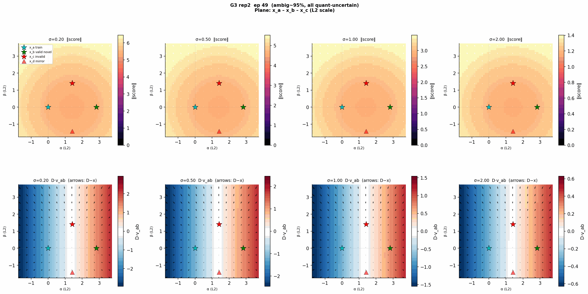

# Generative Rule Learning Dynamics

Official project repository for **The two clocks and the innovation window: When and how generative models learn rules**.

We study when generative models learn rules, memorize training examples, and generate novel valid samples. The experiments compare diffusion and autoregressive models on discrete-rule tasks, with extensions toward more naturalistic rendered images and language.

<p align="center">
  <a href="assets/landscape-dynamics.gif"></a>
</p>

**How does the denoising landscape change as a model learns?** Training dynamics on a two-dimensional slice for group parity ($G=3$, $D=36$, $N=4096$). Columns show noise scales $\sigma=0.2,0.5,1,2$; rows show score magnitude and a projected denoiser component, with arrows indicating the corresponding fields. Cyan, green, and red stars mark training, valid-novel, and invalid examples. [View full size and provenance](assets/README.md).

## Current release: tasks, models and training foundations

This first migration provides rule sampling and checking, Block/Orb/Flower rendering and decoding, the four Light-switch prompts and parser, explicit memorization metrics, onset extraction, and a portable Block/Orb clock figure pipeline.

The same 57 legacy-contract tests were run on the research implementation **before** migration and on the new package afterward. Additional tests cover metric denominators, missing data, all 24 cached image onsets/bounds and package independence. Reference outputs and source hashes are checked in; tests do not need the research repository, cluster storage or model downloads.

The second migration adds DiT/EDM, the Hugging Face GPT model and sampler, the original diffusion trainer, a portable GPT training CLI, and Qwen SFT preprocessing/evaluation helpers. Model contracts were frozen before migration: fixed forward/loss/sampling outputs, three-step optimizer updates and legacy-created small checkpoints. Qwen tests use its actual tokenizer and actual TRL masking with a tiny CPU model.

The main reference environment passes 87 tests; Qwen integration tests run separately in the recorded LLM environment. MLP/UNet/ESM variants, all historical large-checkpoint checks, zero-shot LLM harnesses and the remaining paper figures are still being migrated. Their existing implementation remains in [DiffusionAttnConsistency](https://github.com/Animadversio/DiffusionAttnConsistency). This release does not yet provide full end-to-end paper reproduction.

## Install and verify

Python 3.10 or newer:

```bash
python -m pip install -e '.[images,models,test,plot]' -c environments/models-reference.txt
python -m pytest -q
python examples/tasks.py --images
python paper/figures/image_clocks.py --out outputs/image_clocks
```

For rules, prompts and timescale analysis alone, `pip install -e .` requires only NumPy. Rendering uses the `images` extra; the original Torch quantizer and packed membership utility use `torch`. Recorded reference versions are in `tests/fixtures/provenance.json`; exact image comparisons are validated in that environment.

The figure command recalculates the onset table from cached trajectories, checks it against the frozen audit, and writes CSV, fit JSON, PDF, PNG and SVG. It reproduces the numerical clock panel rather than the complete typeset Figure 5.

## Layout

| Directory | Purpose |
| --- | --- |
| `src/genrule/rules/` | Parity, exact-K, row-K variants, Latin square and existing Sudoku utilities |
| `src/genrule/datasets/` | Shared latent grids, image encoders/decoders and language task/prompts/parser |
| `src/genrule/evaluation/` | Exact training-set membership and metrics with explicit denominators |
| `src/genrule/analysis/` | Consecutive crossings, legacy persistence and image-audit persistence |
| `src/genrule/io/` | Portable cached-data readers |
| `src/genrule/models/` | DiT/EDM and GPT architecture/sampling |
| `src/genrule/training/`, `cli/` | Training loops, Qwen SFT helpers and portable entry points |
| `paper/` | Figure manifest, cached numerical data and reproduction scripts |
| `tests/fixtures/` | Frozen legacy outputs and provenance |
| `examples/` | Small CPU examples |

See [the reproducibility contract](docs/reproducibility.md) for acceptance criteria and [the migration record](docs/migration.md) for preserved conventions and remaining work.

See [training commands and environment setup](docs/training.md), [model reproducibility targets](docs/model_reproducibility.md), and [third-party attribution](THIRD_PARTY_NOTICES.md).
